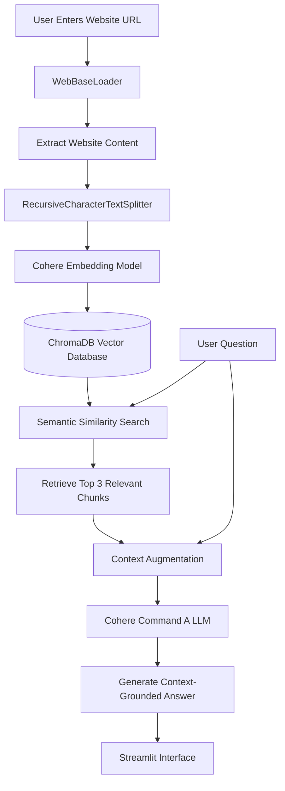

# Ask Any Website — RAG-Powered Question Answering System

A Retrieval-Augmented Generation (RAG) application that allows users to interact with website content through natural-language questions.

Built using **LangChain, Cohere, ChromaDB, and Streamlit**, the application extracts website content, transforms it into vector embeddings, retrieves relevant information using semantic similarity search, and generates context-aware answers using a Large Language Model (LLM).

## Overview

Traditional language models rely primarily on knowledge acquired during training and may struggle to answer questions about specific website content.

**Ask Any Website** addresses this limitation using Retrieval-Augmented Generation (RAG), combining information retrieval with LLM-based response generation.

Users can provide a website URL, index its content, and ask questions grounded in the retrieved website information.

## Features

- **Website Content Extraction:** Extracts website content using LangChain's WebBaseLoader.
- **Intelligent Text Chunking:** Splits documents into manageable chunks while preserving overlapping context.
- **Vector Embeddings:** Converts website content into semantic embeddings using Cohere.
- **Vector Database:** Stores document embeddings persistently using ChromaDB.
- **Semantic Search:** Retrieves the three most relevant document chunks for each query.
- **Context-Aware Generation:** Generates responses using Cohere's Command A model.
- **Grounded Question Answering:** Instructs the model to answer exclusively from retrieved context.
- **Interactive Interface:** Provides a Streamlit interface for website processing and querying.

## System Architecture



## Tech Stack

| Category | Technology |
|----------|------------|
| Programming Language | Python |
| LLM Framework | LangChain |
| Large Language Model | Cohere Command A |
| Embedding Model | Cohere embed-english-v3.0 |
| Vector Database | ChromaDB |
| Document Loader | WebBaseLoader |
| Text Splitting | RecursiveCharacterTextSplitter |
| Frontend | Streamlit |
| Environment Management | python-dotenv |

## Project Workflow

### 1. Website Content Extraction

The user provides a website URL, and the application extracts its content using LangChain's `WebBaseLoader`.

```python
def load_docs(url):
    loader = WebBaseLoader(url)
    docs = loader.load()
    return docs
```

### 2. Document Chunking

Extracted content is divided into smaller chunks using `RecursiveCharacterTextSplitter`.

**Configuration:**

- Chunk Size: 800 characters
- Chunk Overlap: 100 characters

```python
def split_docs(docs):
    splitter = RecursiveCharacterTextSplitter(
        chunk_size=800,
        chunk_overlap=100
    )
    return splitter.split_documents(docs)
```

Chunk overlap helps preserve contextual information across adjacent document segments.

### 3. Embedding Generation and Vector Storage

Each document chunk is converted into a vector representation using Cohere's embedding model.

The embeddings are stored in a persistent ChromaDB database for semantic retrieval.

```python
def create_vector_db(splitted_docs):
    embeddings = CohereEmbeddings(
        model="embed-english-v3.0"
    )

    db = Chroma.from_documents(
        splitted_docs,
        embeddings,
        persist_directory="db/chroma_db"
    )

    return db
```

### 4. Semantic Similarity Search

When the user submits a question, the application searches the vector database to identify relevant document chunks.

```python
def retrieve_query(query, db):
    retriever = db.as_retriever(
        search_kwargs={"k": 3}
    )

    result = retriever.invoke(query)
    return result
```

The retriever returns the top three matching document chunks.

### 5. Context-Aware Answer Generation

Retrieved chunks are combined into a context and provided to Cohere's Command A language model.

The prompt instructs the LLM to generate an answer using only the supplied context.

```python
def gen_result(context, query):
    model = ChatCohere(
        model="command-a-03-2025"
    )

    prompt = f"""
You are a question answering system.

Use ONLY the provided context to answer the question.

If the context does not contain the answer, reply exactly:
"I don't know based on the provided context."

Context:
{context}

Question:
{query}
"""

    result = model.invoke(prompt)
    return result.content
```

This prompting strategy aims to reduce unsupported responses and encourage context-grounded answers.

## Installation and Setup

### Prerequisites

- Python 3.10 or higher
- pip
- Cohere API key

### Step 1: Clone the Repository

```bash
git clone https://github.com/ajmani-x/ask-any-website-rag.git
cd ask-any-website-rag
```

### Step 2: Create a Virtual Environment

**macOS/Linux:**

```bash
python3 -m venv venv
source venv/bin/activate
```

**Windows:**

```bash
python -m venv venv
venv\Scripts\activate
```

### Step 3: Install Dependencies

```bash
pip install -r requirements.txt
```

### Step 4: Configure Environment Variables

Create a `.env` file in the project root directory.

```env
COHERE_API_KEY=your_cohere_api_key
```

Never commit your actual API key to GitHub.

### Step 5: Run the Application

```bash
streamlit run app.py
```

Replace `app.py` with your actual Python filename if different.

Streamlit will start a local development server, typically available at:

http://localhost:8501

## How to Use

**Step 1:** Launch the Streamlit application.

**Step 2:** Enter the URL of a website you want to analyze.

**Step 3:** Click **Process Website** to extract, chunk, embed, and index the website content.

**Step 4:** Enter a natural-language question about the processed website.

**Step 5:** Click **Get Answer** to retrieve relevant context and generate a response.

### Example

**Website:**

```text
https://docs.python.org/3/tutorial/
```

**User Question:**

```text
What are Python lists and how are they used?
```

**Expected Behavior:**

The system retrieves relevant content about Python lists from the indexed documentation and uses it to generate an answer grounded in that content.

Actual responses depend on the website content and retrieved chunks.

## Project Structure

```text
ask-any-website-rag/
│
├── app.py
├── requirements.txt
├── .env
├── .gitignore
├── README.md
│
└── db/
    └── chroma_db/
```

The `db/chroma_db/` directory is created automatically when documents are indexed.

## Technical Highlights

### Retrieval-Augmented Generation

Instead of sending the entire website content directly to the LLM, the system retrieves relevant chunks before generating a response.

This approach helps reduce irrelevant context and focuses generation on information related to the user's query.

### Persistent Vector Storage

ChromaDB stores embeddings on disk, allowing the application to reload previously indexed data.

### Semantic Retrieval

Cohere embeddings capture semantic relationships between queries and document content, enabling similarity-based retrieval rather than relying exclusively on keyword matching.

### Context-Grounded Responses

The generation prompt constrains the model to retrieved context and specifies a fallback response when the answer is unavailable.

This reduces the likelihood of unsupported answers, although it does not completely eliminate hallucinations.

## Current Limitations

- The application processes a single supplied URL rather than automatically crawling an entire website.
- Some websites may restrict automated content extraction or require JavaScript rendering.
- The current implementation uses one shared ChromaDB directory, so documents from previously processed URLs may remain indexed.
- Responses do not currently display source citations.
- The application uses a fixed retrieval configuration of `k=3`.
- LLM response quality depends on successful extraction and retrieval of relevant content.

## Learning Outcomes

This project demonstrates practical implementation of:

- Retrieval-Augmented Generation (RAG)
- Document ingestion and preprocessing
- Recursive text splitting
- Embedding generation
- Vector database integration
- Semantic similarity search
- LLM prompt construction
- Context-grounded answer generation
- Streamlit application development
